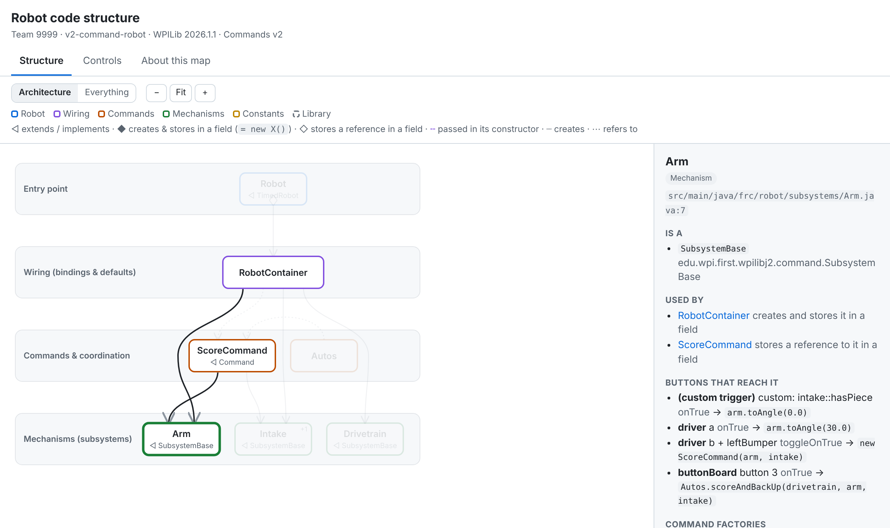

# SCREAM Tools

Free, open-source [Claude Code](https://code.claude.com) tools for FRC robot programming teams.
Use them, fork them, change them — they are MIT licensed.

Each tool runs **with Claude Code** as a slash command, or **without Claude Code** as a plain
program — see [Use with Claude Code](#use-with-claude-code) and
[Use without Claude Code](#use-without-claude-code).

| Tool | Slash command | What it does |
| --- | --- | --- |
| **frc-visualize-code** | `/frc-visualize-code` | Maps a WPILib Java robot project, starting from `Robot.java`, into an interactive HTML page and SVG diagrams: classes, mechanisms, commands, libraries, controller bindings and default commands. |

---

## frc-visualize-code




*Screenshots are of the small example robot in `tests/fixtures/v2-command-robot`.*

Run it in your robot project, with or without Claude Code, and it writes `docs/projVisu/`:

| File | Contents |
| --- | --- |
| `index.html` | Interactive page. **Structure**: class diagram; click a class for its fields, command factories, links, and the buttons that reach it. **Controls**: every trigger binding and default command, grouped by controller, with the mechanisms each command refers to. **About**: project facts and warnings. |
| `structure.svg` | Architecture diagram (constants and minor references hidden). |
| `structure-full.svg` | Every class reachable from `Robot`, including constants and library code. |
| `structure.json` | The extracted graph, if you want to build on it. |

The page is one self-contained file. It loads nothing from the internet, so it works offline in the
pits, and it follows light/dark mode.

### What it understands

- **Commands v2 and Commands v3**, including both on one robot.
- **2026 and earlier** (`edu.wpi.first.*`) and **2027** (`org.wpilib.*`) package names.
- Subsystems: anything that extends `SubsystemBase` or implements `Subsystem` (v2) or
  `Mechanism` (v3), directly or through a base class whose source is in the repository (for
  example a vendored library like SCREAMLib's `TalonFXSubsystem`).
- Bindings: `onTrue`, `whileTrue`, `toggleOnTrue`, `onFalse`, `whileFalse`, `onChange` (and the
  pre-2023 names) on `Command*Controller` / `CommandGamepad` / `CommandJoystick` buttons,
  `JoystickButton`, `POVButton`, `new Trigger(...)`, and combinations with `.and()`, `.or()`,
  `.negate()`. Controller ports are resolved through constants.
- Default commands: every `setDefaultCommand(...)`.
- For each bound command, the **mechanisms it refers to**, following method calls a few levels deep
  (e.g. `superstructure.shoot()` → the flywheel, indexer and drive it uses).

### How it works, and its limits

It is a single Java file (`plugins/scream-tools/skills/frc-visualize-code/scripts/FrcVisualize.java`)
that reads your source with the JDK's own Java parser. **No downloads, no dependencies, no build**:
it runs on the JDK the WPILib installer already put on your laptop, and it works even when the
project does not compile. The same code always produces the same map, so a committed map only
changes when the code does.

It reads source text only. It never compiles or runs robot code. So:

- The "mechanisms" for each binding are an **estimate** from the source — not the command's
  declared requirements. Check the command before relying on it.
- Anything decided at runtime (auto choosers, reflection, generated code) is not visible.
- Libraries you pull in as jars (WPILib, vendor libraries) are not drawn; libraries whose source is
  in your repository are.

## Requirements (both ways)

- A **JDK 17 or newer**. The WPILib installer already gives you one. The launcher script looks for
  the WPILib JDK first (`~/wpilib/<year>/jdk`, `~/.local/share/wpilib/<year>/jdk`,
  `C:\Users\Public\wpilib\<year>\jdk`), then `JAVA_HOME`, then `java` on your `PATH`. Set
  `FRC_VISUALIZE_JAVA` to force a specific `java`.
- The JDK must be at least as new as the Java your robot code uses. WPILib's own JDK always is.
- On Windows, run the launcher through Git Bash (Claude Code on Windows already uses it), or call
  `java` directly as shown below.

---

## Use with Claude Code

The slash command runs the same program, then reads the result and reports on it: framework and
counts, any warnings, and things worth a look, such as the same button bound twice, a binding whose
mechanisms it could not identify, or a mechanism no button or default command reaches. It does
not edit robot code and does not commit unless you ask.

### Install as a plugin (recommended)

In Claude Code:

```
/plugin marketplace add brsnell/scream-tools
/plugin install scream-tools@scream-tools
```

Then, in your robot project:

```
/scream-tools:frc-visualize-code
```

Plugin skills are namespaced by the plugin name. Claude Code may also accept the short form
`/frc-visualize-code` when nothing else has that name.

### Or copy the skill into one project

Copy `plugins/scream-tools/skills/frc-visualize-code/` into your robot project at
`.claude/skills/frc-visualize-code/`. It then runs as `/frc-visualize-code`.

---

## Use without Claude Code

The tool itself does not use AI. It is a plain Java program, so you can run it on any laptop or
CI machine with no account, no API key and no internet connection.

### On your laptop

Clone or download this repository once, then from your robot project folder:

```bash
# macOS, Linux, or Git Bash on Windows (finds the WPILib JDK for you)
path/to/scream-tools/plugins/scream-tools/skills/frc-visualize-code/scripts/run.sh

# or anywhere, with any JDK 17+ on your PATH (works in Windows PowerShell too)
java path/to/scream-tools/plugins/scream-tools/skills/frc-visualize-code/scripts/FrcVisualize.java
```

Then open `docs/projVisu/index.html` in a browser.

| Option | Default |
| --- | --- |
| `--project DIR` | the current folder |
| `--out DIR` | `<project>/docs/projVisu` |
| `--root CLASS` | the class extending `TimedRobot` (or named `Robot`) |

Exit codes: `0` done · `2` bad arguments or no Java sources · `3` no robot entry class found
(pass `--root`) · `4` no JDK 17+ found.

### Automatically, with GitHub Actions

[`examples/github-actions/frc-visualize-code.yml`](examples/github-actions/frc-visualize-code.yml)
keeps the map in your robot repository up to date. Copy it into your robot project as
`.github/workflows/frc-visualize-code.yml`. On every push to `main` that changes robot code, it
regenerates `docs/projVisu/` and commits the result. It uses no AI and needs no secrets.

- The output is deterministic, so a push that does not change the map commits nothing.
- If `main` is protected so that only pull requests can change it, the bot's push will be
  rejected. Either allow GitHub Actions to push, or change the last step to upload
  `docs/projVisu` as a build artifact instead.
- The example uses the latest tool from `main`. To make sure the map only changes when your code
  does, pin `ref:` to a commit SHA from this repository.

**Publish it for your drive team.** With the map committed, turn on GitHub Pages in your robot
repository (Settings → Pages → Deploy from a branch → `main`, folder `/docs`). The page is then at
`https://<owner>.github.io/<repo>/projVisu/`, readable on a phone in the pits. GitHub Pages on a
private repository needs a paid GitHub plan.

---

## Develop

```bash
tests/run-tests.sh
```

This runs the tool on the two fixture robots in `tests/fixtures/` (a Commands v2 robot on 2026
package names and a Commands v3 robot on 2027 package names) and checks what it extracts. It also
checks that output is identical across runs and that the page loads nothing from the network. CI
runs the same tests on Linux, macOS and Windows with JDK 17, 21 and 25.

Contributions are welcome. If the tool misreads your team's code, a pull request that adds a small
fixture reproducing it is the most useful thing you can send.

## Fork it

The license is MIT: fork it and make it yours. To publish your fork as its own plugin marketplace,
change `name` and `owner` in `.claude-plugin/marketplace.json`. Teams then install it with
`/plugin marketplace add <your-org>/<your-repo>`.

## License

[MIT](LICENSE)
